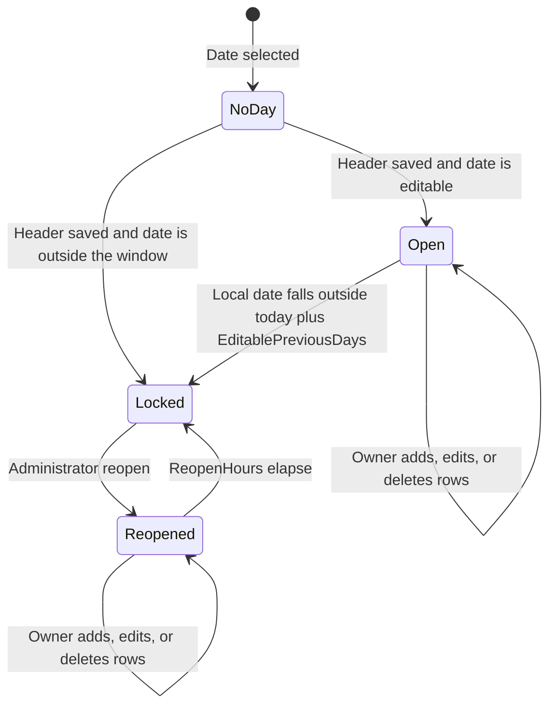

# Product requirements

Websters Lawyers timesheet. This document describes the application that is already implemented in this repository. It is the behavioral source of truth for developers and coding agents. Operational detail remains in `PROGRAMMERS_GUIDE.md`, `DATABASE_STRUCTURE.md`, and `DEPLOYMENT_HANDOVER.md`.

Payroll, biometric attendance, GPS, projects, departments, and an approval workflow are **not** requirements. They are out of scope until a client decision says otherwise.

## 1. Overview

Staff record a working day as one timesheet: a clock-in time, then ordered tasks measured in whole units. The server turns units into a timeline. Breaks stay on the timeline and are excluded from productive time.

The product replaces the client Excel time log. It keeps that log's shape: display name, date, start, finish, units, duration, task type, description, and explanatory notes.

### Objectives

- One timesheet per person per local date.
- Time is derived from clock-in plus units. Staff do not type start and finish separately.
- Historical durations stay stable when task types or the firm-wide unit setting change.
- Employees see and change only their own days, inside an edit window.
- An unlocked administrator can review the team, manage the catalogue, reopen a locked day, export, and configure backups.
- Sign-in is the Windows session. Employees do not have a separate application password.

## 2. Scope

| In scope | Out of scope |
|---|---|
| Windows authentication and automatic employee profile | Username/password accounts for employees |
| Shared administration password | Per-person administrator role flag |
| Daily timesheet, task rows, breaks, file-closure counts | Submit, approve, or reject states |
| List and calendar for one day or a team range | Overtime rules, schedules, or payroll |
| Excel and CSV export; SQL reporting view | Power BI reports inside the app |
| Employee directory and task-type catalogue | Departments, projects, clients, or matters |
| Minutes-per-unit default and database backup | Restore automation, GPS, biometrics, email alerts |

## 3. Roles

There are two access modes, not two account types. Any active employee who knows the administration password can unlock administration.

| Mode | Who | Can |
|---|---|---|
| Employee | Active Windows user with a profile | Open My timesheet, edit own days in the window, export own rows |
| Administrator | Same person, after a successful unlock | Team overview, reopen, employees, task types, unit setting, backup, admin export, change the administration password |

An inactive profile cannot use the application. An administrator cannot edit another person's rows. Reopen lets the **owner** edit that day until the reopen window ends.

Client Review is a non-production environment with sample data and its own cookie. It is not a third business role.

## 4. Feature index

| ID | Feature |
|---|---|
| TS-001 | Windows sign-in and employee profile |
| TS-002 | Administration unlock, lock, and password change |
| TS-003 | Daily header: display name and clock-in |
| TS-004 | Task rows: add, edit, delete |
| TS-005 | Breaks and on-screen totals |
| TS-006 | Timeline and midnight limit |
| TS-007 | Edit window and reopen |
| TS-008 | List, calendar, and filters |
| TS-009 | Personal Excel and CSV export |
| TS-010 | Team overview and admin export |
| TS-011 | Employee directory |
| TS-012 | Task-type catalogue |
| TS-013 | Minutes-per-unit setting |
| TS-014 | Database backup and retention |
| TS-015 | Template import |
| TS-016 | Diagnostic logging |

## 5. Lifecycle

There is no draft, submitted, approved, or rejected status. A day exists after the header is saved. Each task is stored when that row is saved.

Future dates are not editable and cannot be reopened. A day with no header cannot have tasks.

## 6. Functional requirements

### TS-001 Windows sign-in and employee profile

**Purpose.** Identify the person from the Windows session.

**Behavior.** Negotiate authentication supplies the Windows SID and account. The first visit creates an active employee: display name and Windows account default to the account name, `CreatedBy` is the SID. Later visits reuse the SID. The process identity and any client-supplied name are ignored. Inactive employees receive "Your employee account is inactive."

**Validation.** Authenticated Windows identity required. SID required. Email, when an administrator sets it, must be a valid address up to 254 characters.

**Acceptance.**

- Two Windows users get two profiles and cannot read each other's rows.
- A repeated visit does not create a second profile.
- An inactive profile receives 403 and cannot save.
- Unauthenticated requests receive 401.

### TS-002 Administration unlock, lock, and password change

**Purpose.** Gate shared administration without giving employees a second login.

**Behavior.** `/account/admin-unlock` checks the shared password against the stored hash. Success sets a non-persistent cookie for 30 minutes, bound to the Windows SID and the settings security stamp. Lock and password change sign that cookie out. Password change rotates the stamp, which invalidates other unlock sessions. Five attempts per identity per minute are rejected with 429. The initial hash is created only by `--initialize` from `Bootstrap:AdminPassword`, which must then be removed.

**Validation.** Password required to unlock. New password 8–128 characters and must match confirmation. Current password required to change it.

**Acceptance.**

- Wrong password does not set the cookie and is logged without the password.
- Expired or stamped-out cookies lose administration pages.
- Password change forces every administrator to unlock again.
- Employee timesheet access continues after lock.

### TS-003 Daily header

**Purpose.** Record who the day is displayed as, and the clock-in that anchors the timeline.

**Behavior.** Display name defaults to the Windows account and may be changed up to 160 characters. Clock-in is a minute value (`HH:mm`). Saving an existing day keeps its `MinutesPerUnit`. The first save of a day copies the current administrator default and rejects the save if the page still has a different rate. Blur or Enter saves the header. There is no separate Save day button.

**Validation.** Date, display name, and clock-in required. Seconds must be zero. The page's unit value must match the server default when the day is created.

**Acceptance.**

- A new day stores the current minutes-per-unit.
- Changing the default later does not change that day.
- A stale page cannot create a day at the old rate.
- Tasks cannot be added until the header exists.

### TS-004 Task rows

**Purpose.** Record work in order.

**Behavior.** A row has whole units, one task type, a description, and, for file-closure types, a file count. New rows append at the next position. Enter on a completed list row saves and starts another row. Each new row sends a client submission id; a repeat of the same id returns the original row. Edit and delete are inline. Delete and edit send the row and day rowversions. Saving an inactive type is refused unless the row already uses that type.

**Validation.** Units 0–1440. Task type required and must exist. Description 0–4000 characters. Description required when the type's rule is Required. Files closed required, 0–1,000,000, when the rule is FilesClosed. The server prefixes `Closed {n} files` when that rule applies. Position and submission id are unique per day.

**Acceptance.**

- Double submit with one submission id creates one row.
- A stale rowversion returns 409 and does not overwrite.
- An employee cannot change another employee's row (404 or 403).
- Zero units are saved; start and finish are equal.
- Deleting a middle row leaves later rows in order; their displayed times move up on the next read.

### TS-005 Breaks and totals

**Purpose.** Show elapsed time and productive time separately.

**Behavior.** New rows copy `IsBreak` from the task type. Changing a row to another type updates that row's snapshot. Editing the type's flag later does not change existing rows. Productive minutes are non-break duration. Break minutes stay in the timeline and in elapsed time. Totals on screen cover the filtered selection, not only the current page: productive time, break time, units, task count, and elapsed time. Team overview also shows daily and weekly productive totals.

**Acceptance.**

- A break row increases elapsed time and break time and does not increase productive time.
- Renaming a task type or clearing its break flag does not change historical productive totals.
- Changing one existing row onto a break type does change that row's snapshot.

### TS-006 Timeline and midnight limit

**Purpose.** Derive start and finish from the clock-in and the unit size.

**Behavior.** Clock-in is stored as entered. It is not rounded. The first row starts at clock-in. Each later row starts when the previous row finishes. Duration minutes = units × that day's `MinutesPerUnit`. Finish may be 24:00. Any total that would pass midnight is rejected. Work after midnight belongs on the next date. Task filters do not change start times; preceding units still count.

**Validation.** `MinutesPerUnit` is 1–60. Sum of units × rate, added to clock-in minutes, must be ≤ 1440.

**Acceptance.**

- Clock-in 08:50 and a 10-unit row at 1 minute per unit finish at 09:00.
- The same row on a day snapshotted at 6 minutes finishes at 09:50.
- A set of rows that crosses midnight is rejected and the previous rows remain.
- Filtering to one task type still shows that row's original start.

### TS-007 Edit window and reopen

**Purpose.** Limit changes to recent days, with a controlled exception.

**Behavior.** A day is editable when it is today or within `Timesheet:EditablePreviousDays` (default 3) local dates, or when `ReopenedUntil` is still in the future. `null` allows every past date. Future dates are never editable. Reopen sets `ReopenedUntil` to now plus `ReopenHours` (default 24, allowed 1–168), and stores the administrator SID and a reason. Configuration changes need a process restart. The edit window is calendar dates in `Timesheet:TimeZone` (default Australia/Adelaide), not a rolling 72 hours.

**Validation.** Reason required, up to 500 characters. The date must not be in the future. A day that already has a timesheet must send its current rowversion. A date with no timesheet is still accepted: the employee can then enter clock-in and tasks until the reopen window ends.

**Acceptance.**

- The owner can edit today and the previous three local dates under the default.
- An older day is read-only, including add, edit, and delete.
- After reopen, only the owner can edit, and only until the deadline.
- Reopen succeeds for a selected employee and past date even when that date has no timesheet. The employee can start the day until the deadline.
- The team screen shows who can no longer edit and offers reopen for a selected day.

### TS-008 List, calendar, and filters

**Purpose.** Review one day or a range without a second entry model.

**Behavior.** My timesheet defaults to the local today in a list. Calendar shows the month, Monday–Sunday, with up to two task names on a day. Choosing a day opens an overview. Employees filter by task type. Administrators also filter by employee and date range. Page sizes are 10, 20, 50, or 100. Date range for queries is at most 367 days. List export and totals use the filter, not the current page.

**Acceptance.**

- Calendar and list show the same saved rows for the selected day.
- Paging does not change a row's start time.
- An administrator with no employee selected is reviewing the team; they do not gain an edit form for another person.

### TS-009 Personal export

**Purpose.** Give the employee the workbook layout.

**Behavior.** Excel uses `Templates/WL-TimeLog.xlsx`. CSV has the same information. The file contains the filtered rows, not one page. Dates and durations are spreadsheet values. Descriptions are neutralized against spreadsheet formulas. The export names the range.

**Acceptance.**

- Own export never includes another employee's rows.
- A one-minute day and a six-minute day in one file each keep their own duration.
- The workbook's old defect of omitting the last data row is not reproduced.

### TS-010 Team overview and admin export

**Purpose.** Let an unlocked administrator review the firm.

**Behavior.** `/admin` uses the same workspace, with employee and date-to filters, reopen, and period totals. Export calls `/api/timesheets/admin-export` and uses `Templates/WL-AdminExport.xlsx`. Columns: Employee, Date, Time Started, Time Finished, Units, Duration, Task Type, Description, and the unit rate. CSV matches. Personal export stays a different endpoint.

**Acceptance.**

- Locked administration cannot open `/admin` or the admin export.
- The export includes every matching row up to the existing export limit, across employees.
- Mixed unit rates stay distinguishable in the file.

### TS-011 Employee directory

**Purpose.** Correct display details and deactivate leavers.

**Behavior.** Administrators search and page employees. They can change display name, email, and active flag. They cannot deactivate their own current Windows account. Windows SID and account are not edited on this screen. Creating profiles remains a side effect of sign-in (TS-001), not a manual create form.

**Acceptance.**

- Deactivating another employee blocks that person's later use.
- The administrator's own active flag cannot be cleared.
- Search and page size reset to page 1; a save refreshes the current page.

### TS-012 Task-type catalogue

**Purpose.** Maintain the list imported from the client workbook.

**Behavior.** Administrators create and edit name (unique, ≤120), explanatory notes (≤2000), active, break, and description rule: Optional, Required, or FilesClosed. Inactive types stay on historical rows and disappear from the picker for new choices. Employees can list active types. Import (TS-015) seeds missing names without overwriting later edits.

**Acceptance.**

- Duplicate names are rejected.
- A type used on old rows can be deactivated and still displays on those rows.
- FilesClosed types show a file-count field; other types do not keep a stored file count.

### TS-013 Minutes per unit

**Purpose.** Let the firm choose the size of one unit for **new** days.

**Behavior.** `/settings` stores an integer 1–60 on the singleton settings row. Example copy: 1 means one minute; 6 means six minutes. Existing days, including later edits, keep the snapshot. The settings rowversion must match.

**Acceptance.**

- Saving 6 affects only days created afterward.
- A value outside 1–60 is rejected.
- Two administrators cannot silently overwrite each other's save.

### TS-014 Database backup and retention

**Purpose.** Take a copy of the SQL Server database on a schedule and delete old copies.

**Behavior.** `/settings/backup` stores enabled flag, interval in days (default 7, range 1–365), retention in days (default 30, range 1–3650), and a folder. Retention must be at least the interval. Automatic backups start off until an administrator enables them. The service checks every 15 minutes, writes `BACKUP DATABASE ... WITH COPY_ONLY, CHECKSUM`, and deletes only its own `.bak` files older than retention. A failed attempt waits one hour. Back up now uses the saved folder and retention. The folder must be visible to SQL Server for the write and to the application identity for deletion. Restore is a manual operator task.

**Acceptance.**

- Defaults shown are 7 and 30.
- Retention shorter than the interval is rejected.
- A successful run records the time and clears the last error.
- Files that do not match this application's backup name are left in place.
- Disabling automatic backup stops the schedule; Back up now still runs after a folder has been saved.

### TS-015 Template import

**Purpose.** Load the client task list once, without sample time rows.

**Behavior.** `--initialize --import-template` inserts missing task names and notes and initial break and detail flags. Existing administrator edits are kept. Sample timesheet rows in the workbook are not imported.

**Acceptance.**

- A second import does not duplicate names.
- An edited note is not replaced by the workbook.

### TS-016 Diagnostic logging

**Purpose.** Record operational events without timesheet content.

**Behavior.** File logs use JSON objects, rotate by UTC day or size, and default to 30 days retention. Business failures are warnings with a client reference and no stack. Unexpected failures are errors. Passwords, descriptions, query strings, and connection strings are not written. See `PROGRAMMERS_GUIDE.md` for the file layout.

**Acceptance.**

- A failed save returns a reference and does not return a stack trace.
- An unlock failure log does not contain the password.

## 7. User stories

| Story | Acceptance |
|---|---|
| As a solicitor, I open `/` from RDS and log today without a second password. | TS-001, TS-003, TS-004 |
| As a solicitor, I enter a break and see productive time fall while the clock still moves forward. | TS-005, TS-006 |
| As a solicitor, I cannot change last month unless an administrator reopens it. | TS-007 |
| As an administrator, I see the team for a date range and download one Excel file. | TS-010 |
| As an administrator, I set new days to six minutes per unit without rewriting last week. | TS-013 |
| As an administrator, I keep a weekly database copy for a month. | TS-014 |

## 8. Navigation and clicks

| Control | Result |
|---|---|
| My timesheet | `/`, list for today |
| List / Calendar | Switches view; calendar selects a day without leaving the month |
| Previous, Next, Today | Moves the day or the visible month |
| Apply filters | Reloads rows, totals, and paging |
| Header blur or Enter | Saves display name and clock-in |
| Enter on a complete new list row | Saves that task and focuses the next units field |
| Excel / CSV | Downloads the filtered export for the current mode |
| Team overview | `/admin` if unlocked; otherwise the unlock page |
| Reopen selected day | Dialog requires a reason; owner can then edit |
| Employees, Task types | Paged directories |
| Timesheet settings | Minutes per unit |
| Database backup | Schedule, folder, Back up now |
| Change admin password | Signs out administration on success |
| Lock administration | Drops the admin cookie; Windows session remains |
| Administration (locked) | `/account/admin-unlock` |

`/timesheet` permanently redirects to `/`.

## 9. Business rules

| Topic | Rule |
|---|---|
| Time entry | Whole units only. Duration and finish are calculated. |
| Breaks | Timeline includes them. Productive totals exclude the snapshot. |
| Overtime | **TBD.** No separate overtime record or rate exists. |
| Editing | Owner only, and only while the day is editable or reopened. |
| Submission | Immediate save. There is no submit action. |
| Approval / rejection | **Not in product.** No approver, comment thread, or rejected state. |
| Display name | Cosmetic for the day and the profile. Ownership stays the Windows SID. |
| File closures | Count is required and written into the description. |
| Zero units | Allowed. |
| Crossing midnight | Rejected. Continue on the next date. |

## 10. Error catalogue

| Condition | Result |
|---|---|
| No Windows authentication | 401 |
| Inactive employee, or administration required | 403 |
| Day or row outside the edit window | 403, read-only message |
| Missing day header | 400, save clock-in first |
| Invalid units, dates, names, or file count | 400 with the field message |
| Unknown task or entry | 404 |
| Stale rowversion or stale unit default | 409, reload |
| Duplicate task-type name | 400 |
| Export format other than xlsx or csv | 400 |
| More rows than the export limit | 400, narrow the filter |
| Backup already running, or folder missing | 400 |
| Password attempts over the limit | 429 |
| Unexpected failure | 500, generic message plus reference |

## 11. Notifications and reporting

No email, Teams, or in-app notification feed is required. **TBD** if the firm later wants a reminder to complete a day.

Reporting that is required:

- On-screen productive, break, unit, task, and elapsed totals.
- Administrator daily and weekly productive totals.
- Personal and admin Excel/CSV.
- `dbo.TimesheetReporting` for a read-only SQL or Power BI consumer. The view does not apply web authorization.

## 12. Nonfunctional requirements that affect use

- Usable on an RDS desktop and a narrow browser. The phone layout stacks the day; it is not a native app.
- Keyboard path on the list: Units, Task type, Description, Enter.
- Saves show a status and keep typed text when they fail.
- Pages that show timesheet data are not cached (`no-store`).
- Times display in the configured zone. Stored instants are UTC.
- Administration unlock lasts 30 minutes and does not slide.
- A backup must not block ordinary edits for a normal firm database; the command timeout is 15 minutes.

## 13. Assumptions

1. The September 2026 client workbook and the 1 October 2026 instruction (1 unit can be 1 minute, site at `/`) are the confirmed rules. The workbook's six-minute formulas are historical, not the current default.
2. Clock-in is not rounded. `RoundStartDown` is unused.
3. A shared administration password is what the client asked for.
4. "Today plus three local dates" is the lock rule, not 72 hours.
5. Sample workbook rows are not production data.
6. Direct SQL access is trusted only for operators and a future read-only reporting login.

## 14. Open questions

| Item | Status |
|---|---|
| Is overtime, flex, or a public holiday calendar required? | TBD |
| Is a submit/approve step required for payroll or a partner? | TBD. Not built. |
| Should administration be limited to named people instead of a shared password? | TBD |
| Who may read `dbo.TimesheetReporting`? | TBD |
| Is a tested restore run on a schedule, and who owns it? | TBD. Backup is built; restore is not. |
| Production host: IIS on Windows 11 Pro with which SQL networking stack? | TBD. See `PROGRAMMERS_GUIDE.md`. |
| Are email reminders required? | TBD |
| Should `EditablePreviousDays` and `ReopenHours` be editable on the administration screen instead of in configuration? | TBD |
