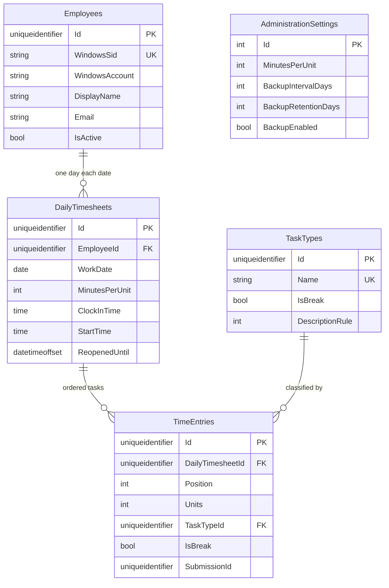

# Technical specification

Implementation map for the existing ASP.NET Core timesheet. Product behavior is in `PRD.md`. Screen layout is in `UI-UX-DESIGN.md`. Schema narrative and migration order also live in `DATABASE_STRUCTURE.md`; this document is the contract those features depend on.

Items marked **Proposal** are not implemented. Do not add them without a product decision.

## 1. Stack

| Piece | Choice |
|---|---|
| Runtime | .NET 10 (`net10.0`) |
| Web | ASP.NET Core MVC, Razor views, cookie and Negotiate auth |
| API | JSON controller actions under `/api` |
| Browser | Razor plus `wwwroot/js` and `wwwroot/css`. No SPA framework |
| Data | EF Core 10.0.12, SQL Server, `Microsoft.Data.SqlClient` 7.0.3 |
| Excel | ClosedXML 0.105.1 and the client `.xlsx` templates |
| Host | Kestrel locally; IIS in production (not yet validated) |
| Windows service | `Microsoft.Extensions.Hosting.WindowsServices`, service name `WLTimeSheet` |

The solution is one web project, `WL TimeSheet/WL TimeSheet.csproj`. A second deployable service is not justified.

## 2. Architecture

```text
Browser (Razor + timesheet.js / site.js)
        |  cookie session, antiforgery, JSON
ASP.NET Core host (Program.cs)
        |  Negotiate or Client Review cookie
        |  AdminUnlocked policy
Controllers  ->  Services  ->  AppDbContext  ->  SQL Server
                     |
                     +-- DatabaseBackupHostedService (15 min)
```

Controllers are thin. `TimesheetService` and `TimesheetPolicy` own calculations and authorization beyond the attribute. The browser may preview a duration; the server result is authoritative.

### Folder layout

| Path | Role |
|---|---|
| `Program.cs` | Host, auth, EF, rate limits, initialize |
| `Controllers/` | MVC pages and JSON |
| `Views/` | Razor screens |
| `wwwroot/` | CSS, JS, icons, logo |
| `Models/Domain.cs` | Entities and input models |
| `Data/` | `AppDbContext` and EF migrations |
| `Security/` | Current employee and administration password |
| `Services/` | Timesheets, exports, import, backup, review seed |
| `Diagnostics/` | Request middleware and file logger |
| `Templates/` | Excel layouts copied to output |
| `deployment/` | Production settings template |
| `docs/` | This set plus the existing operator guides |

### Responsibilities

| Browser | Server |
|---|---|
| Filters, paging controls, keyboard row | Query, page, and totals |
| Duration preview | Timeline and midnight check |
| Submission UUID | Idempotent insert |
| Rowversion round-trip | Concurrency rejection |
| Administration forms | Password verify, settings, backup execution |

## 3. Database

SQL Server database `WLTimesheet`. GUID keys are generated in the application. Audit clocks are UTC. `WorkDate` is a date in the configured zone. Optimistic concurrency is a SQL `rowversion`.

Entities below exist because a feature needs them. Departments, projects, schedules, approval records, and a separate users table are omitted on purpose.

### Why each table exists

| Table | Needed for | Not a substitute for |
|---|---|---|
| `Employees` | TS-001, TS-011. Windows profile | A login account |
| `DailyTimesheets` | TS-003, TS-007. One day per person | A status workflow |
| `TimeEntries` | TS-004, TS-005, TS-006 | Free-form start/finish columns |
| `TaskTypes` | TS-012, TS-015 | Hard-coded dropdowns |
| `AdministrationSettings` | TS-002, TS-013, TS-014. Exactly one row | Per-user roles |
| `TimesheetReopens` | TS-007. Lets an administrator reopen a date before a timesheet exists | A second timesheet |

Optional and **not created**:

| Candidate | Why it is absent |
|---|---|
| Departments | No requirement |
| Projects / matters | No requirement. Description text holds the narrative |
| Approval records | No submit/approve feature |
| Work schedules | No roster |
| Users separate from employees | Windows SID is the identity |
| Audit-log table | Audit columns plus file logs. A general audit table is a **Proposal** if compliance later requires before/after values |
| Backup file catalogue | File names and `LastBackupAt` are enough |

### Relationships



`AdministrationSettings` has no foreign key. `Id` must be 1.

### Columns

**Employees.** `Id` uniqueidentifier; `WindowsSid` nvarchar(184) unique where not null; `WindowsAccount` nvarchar(255); `Email` nvarchar(254); `DisplayName` nvarchar(160); `IsActive` bit; `CreatedAt`, `UpdatedAt` datetimeoffset; `CreatedBy`, `UpdatedBy` nvarchar(255); `Version` rowversion.

**TaskTypes.** `Id`; `Name` nvarchar(120) unique; `ExplanatoryNotes` nvarchar(2000); `IsActive`; `IsBreak`; `DescriptionRule` int constrained 0–2 (Optional, Required, FilesClosed); audit columns and rowversion.

**DailyTimesheets.** `Id`; `EmployeeId` FK restrict; `WorkDate`; unique (`EmployeeId`, `WorkDate`); `MinutesPerUnit` int 1–60; `DisplayName` nvarchar(160); `ClockInTime` and `StartTime` time(0) with zero seconds; `ReopenedUntil` datetimeoffset null; `ReopenedBy` nvarchar(255); `ReopenReason` nvarchar(500); audit and rowversion. Index on `WorkDate`.

**TimeEntries.** `Id`; `DailyTimesheetId` FK restrict; `Position` int > 0, unique with the day; `Units` int 0–1440; `TaskTypeId` FK restrict; `IsBreak`; `Description` nvarchar(4000); `FilesClosed` int null or 0–1000000; `SubmissionId` unique with the day; audit and rowversion.

**AdministrationSettings.** `Id` int = 1; `MinutesPerUnit` 1–60; `PasswordHash` nvarchar(1000); `SecurityStamp` uniqueidentifier; `BackupEnabled` bit; `BackupIntervalDays` int 1–365; `BackupRetentionDays` int 1–3650 and ≥ interval; `BackupDirectory` nvarchar(400); `LastBackupAt`, `LastBackupAttemptAt` datetimeoffset null; `LastBackupError` nvarchar(1000) null; `ModifiedAt`, `ModifiedBy`, rowversion.

`dbo.TimesheetReporting` is a view: entry, day, employee, task, duration minutes, productive minutes, and windowed `StartAt` / `FinishAt`. It is not secured by the web filters.

### Constraints that block bad time data

- One day per employee and date.
- Unique position and unique submission id per day.
- Units and file counts in range.
- Day length enforced in `TimesheetPolicy.CheckLength` (midnight). The database does not store start and finish, so it cannot express that rule alone.
- Restrict deletes so a task type or employee with rows cannot disappear.
- Inactive task types are rejected in the service for new choices.
- Employees can only load days for their own id unless the caller is an unlocked administrator, and even then writes stay on the owner path.

## 4. HTTP surface

Antiforgery applies to MVC posts and to JSON calls via `X-CSRF-TOKEN`. Authenticated session required unless noted.

| Method | Path | Policy | Feature |
|---|---|---|---|
| GET | `/` | Employee | TS-008 |
| GET | `/timesheet` | Employee | Redirect to `/` |
| GET | `/admin` | Admin | TS-010 |
| GET | `/employees`, `/task-types` | Admin | TS-011, TS-012 |
| GET/POST | `/settings` | Admin | TS-013 |
| GET/POST | `/settings/backup`, POST `/settings/backup/run` | Admin | TS-014 |
| GET/POST | `/account/admin-unlock` | Employee, rate limited | TS-002 |
| POST | `/account/admin-lock`, `/account/password` | Password change requires admin | TS-002 |
| GET | `/api/timesheets` | Employee; own rows unless admin | TS-008 |
| GET | `/api/timesheets/day` | Same | TS-003 |
| PUT | `/api/timesheets/day` | Owner | TS-003 |
| GET | `/api/timesheets/calendar` | Same as list | TS-008 |
| POST/PUT/DELETE | `/api/timesheets` and `/api/timesheets/{id}` | Owner | TS-004 |
| POST | `/api/timesheets/reopen` | Admin | TS-007 |
| GET | `/api/timesheets/export` | Own export | TS-009 |
| GET | `/api/timesheets/admin-export` | Admin | TS-010 |
| GET/PUT | `/api/employees`, GET `page` | Admin | TS-011 |
| GET | `/api/task-types` | Employee; inactive list needs the flag | TS-012 |
| POST/PUT | `/api/task-types`, GET `page` | Admin | TS-012 |
| GET/POST | `/review/login` | Anonymous, ClientReview only | Preview |

List and directory page sizes: 10, 20, 50, 100. Date span: at most 367 days. Export refuses an unbounded result (`Too many entries`).

JSON errors from `BusinessException` use the message and status. Concurrency is 409. The client must not treat a 200 as success if the body is an error page.

## 5. Authentication and authorization

**Employees.** Negotiate (IIS Windows Authentication in production). `CurrentEmployee` resolves `WindowsIdentity` SID. Client Review replaces Negotiate with a cookie and a fixed sample SID; that host must use database `WLTimesheetReview`.

**Administration.** Policy `AdminUnlocked`. Cookie `__Host-WLAdmin`: HttpOnly, Secure, SameSite Strict, 30 minutes, not sliding. The handler requires the same SID as the Windows user and a stamp equal to `AdministrationSettings.SecurityStamp`.

**Passwords.** `PasswordHasher<AdministrationSettings>`, 210,000 PBKDF2 iterations. Unlock and password posts are limited to 5 per minute per identity. Review login is 10 per minute for the whole preview.

There is no role table. Do not add `[Authorize(Roles = "Admin")]` unless the product decision in `PRD.md` changes.

## 6. Validation and errors

Input models use data annotations. Services repeat the rules that protect invariants. `BusinessException` is the expected failure. `DbUpdateConcurrencyException` becomes a reload message. `RequestDiagnosticsMiddleware` maps unexpected exceptions to a generic 500 with a reference.

Do not trust client start, finish, productive minutes, or `IsBreak` on insert. `IsBreak` is copied from the task type when the row is created or when its type changes.

## 7. Logging and audit

Row audit: `CreatedAt`, `CreatedBy`, `UpdatedAt`, `UpdatedBy`, and rowversion on employees, days, entries, and task types. Settings store `ModifiedAt` and `ModifiedBy`. Reopen stores `ReopenedBy` and `ReopenReason`.

File logger: see TS-016 and `PROGRAMMERS_GUIDE.md`. Log employee and timesheet ids, not description text or secrets.

## 8. Security and privacy

- HTTPS in production. HSTS outside Development. Kestrel limited to HTTP/1.1 so Negotiate can complete.
- Headers: `nosniff`, `same-origin` referrer, CSP defaulting to `'self'`.
- Antiforgery on mutating requests.
- CSV formula neutralization on export.
- Output encoding in Razor and the JS `esc` helper.
- SQL via EF parameters. Backup database name is bracket-escaped; the file path is a parameter.
- Backup folder must sit outside the content and web roots.
- Data Protection keys in a configured directory, DPAPI on Windows.
- Connection strings and `Bootstrap:AdminPassword` are user secrets or environment variables, never migrations or docs.
- Service identity is the SQL login. The app does not impersonate the employee in SQL.
- Direct access to the reporting view bypasses the web rules. Grant it only to a read-only reporting principal.

## 9. Configuration

| Key | Default | Effect |
|---|---|---|
| `ConnectionStrings:Timesheet` | Required | SQL Server |
| `Timesheet:TimeZone` | `Australia/Adelaide` | Local today and the edit window |
| `Timesheet:EditablePreviousDays` | `3` | Past dates still editable. `null` means all past dates |
| `Timesheet:ReopenHours` | `24` | Length of a reopen. Validated 1–168 |
| `Bootstrap:AdminPassword` | Unset after init | First hash only |
| `Logging:DiagnosticFile` | Enabled, 10 MB, 30 days | File logs |
| `DataProtection:KeyDirectory` | Deployment-specific | Key ring |
| `AllowedHosts` | `localhost` in development | Host filter |

Backup schedule itself is in `AdministrationSettings`, not in `appsettings`.

Startup refuses to run when migrations are pending. `--initialize` applies migrations and, only if the settings row is missing, stores the bootstrap hash. `--import-template` runs the idempotent catalogue import.

## 10. Backup implementation

`DatabaseBackupHostedService` waits 20 seconds, then every 15 minutes calls `DatabaseBackupService`. A process-wide lock prevents overlap with Back up now. The SQL command is copy-only with checksum, timeout 900 seconds. File name: `{database}-{yyyyMMdd-HHmmss}.bak` in UTC. Retention uses last-write time and that name pattern.

The SQL login needs `BACKUP DATABASE`. Copy-only avoids becoming the differential base. This does not replace a restore drill.

## 11. Testing

| Layer | What to prove |
|---|---|
| Service rules | Midnight limit, own-row enforcement, submission id, break snapshot, unit snapshot, reopen expiry |
| Authorization | Admin routes reject a Windows user who has not unlocked |
| Migration | MinuteUnits converts once; custom daily rates block the ConfigurableUnits downgrade |
| Export | Personal and admin workbooks keep each row's duration and rate |
| Backup | Name match ignores unrelated `.bak` files; retention cannot be shorter than the interval |
| Manual RDS | Two Windows users, unlock, lock, export, reopen |

`artifacts/minute-verification` is an offline export and validation check. It is not a full host test. There is no browser automation suite in the repo.

## 12. Deployment and migrations

Publish with `dotnet publish -c Release`. Include `Templates/`. IIS pool is No Managed Code, Windows Authentication on, anonymous off. Apply migrations with the site stopped:

`dotnet "WL TimeSheet.dll" --environment Production --initialize`

Then start the site. The deployment identity may differ from the runtime identity: runtime needs DML and `BACKUP DATABASE`; initialize needs DDL.

Current migrations, in order: `InitialCreate`, `WindowsDailyTimesheets`, `MinuteUnits`, `ConfigurableUnits`, `DatabaseBackup`.

Production SQL networking (managed driver versus Microsoft's native package) is an open decision documented in `PROGRAMMERS_GUIDE.md`. Do not describe the current switch as production-certified.

## 13. Quality bar

| Quality | Target |
|---|---|
| Performance | A day and a paged team list respond interactively on the firm LAN. Exports are bounded by the existing row limit |
| Reliability | Pending migrations stop startup. Backup failure is stored and retried after an hour, without deleting the previous file first |
| Maintainability | One project, feature logic in services, schema only through EF migrations |
| Privacy | Timesheet descriptions are not in logs or error pages |

A microservice split, a second frontend, and an event bus are out of proportion to this application.
